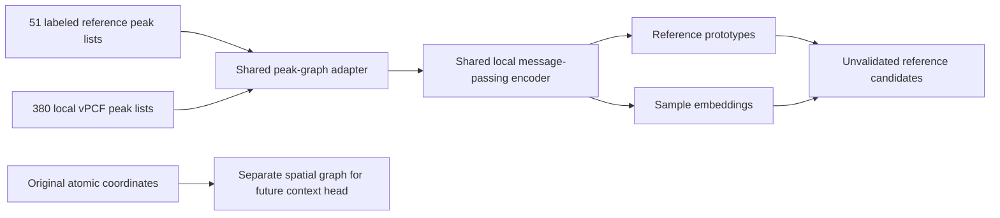

# PIGNN development

Graph inputs and a reference-library encoder for the next phase of the vPCF
project. This directory owns the physics-informed model's code, configuration,
tests, documentation and development results. Earlier DEC/IDEC work is unchanged.

The implemented stage is a geometry-aware graph/encoder foundation. A validated
physics-informed phase/interface classifier remains future work. The current
library has 51 phase-and-view references, not six validated bulk/interface classes.

## Implemented

- One local peak graph per original H5 vPCF, preserving all 380 sample IDs and
  original atomic coordinates for map-back.
- The same graph representation for the 51 stored simulation-library entries.
- A separate spatial graph joining the 380 atomic sample sites.
- A PyTorch message-passing encoder, optional invariant mode, prototype bank,
  reference-fitting routine, checkpoint reload and candidate-reference export.
- A denoising edge-distance reconstruction objective, plus explicit parent-group
  and buffered spatial split utilities.
- Tests for data contracts, graph integrity, permutation behavior, optional rigid
  symmetry behavior, graph-batch isolation, training, reload and split leakage.

## Layout

```text
PIGNN/
  configs/default.json       fixed, explicit development settings
  src/pignn/                 data contracts, graphs, encoder, fitting, splits
  scripts/pignn_pipeline.py   reproducible prepare / train-reference / encode CLI
  tests/                     independent synthetic fixtures and model tests
  docs/                      design decisions, data contracts, evaluation, citations
  results/                   reproducible development runs and figures
  pyproject.toml             dedicated dependency/package definition
```

## Run



From this directory, using an environment with the dependencies in
`pyproject.toml` (PyTorch, not TensorFlow):

```powershell
python -m unittest discover -s tests -v
python scripts/pignn_pipeline.py prepare --output results/<run>/inputs
python scripts/pignn_pipeline.py train-reference --inputs results/<run>/inputs --output results/<run>/encoder
python scripts/pignn_pipeline.py encode --inputs results/<run>/inputs --checkpoint results/<run>/encoder/reference_encoder.pt --output results/<run>/candidates
python scripts/verify_run.py --run results/<run>
```

Output directories must be new. The defaults read the original H5 under the
parent `Data/` directory and the existing simulation library under
`Unused Data/data/saved_vpcfs/`. Inputs are read-only. `prepare` reads fitted
peak lists, not the 794 MB image stack. Existing `results/` folders outside this
directory are not reused for training. Install locally with `python -m pip
install -e .` if desired, or use the scripts directly without installation.

## Important interpretation

The source H5 and library JSON do not establish a shared physical calibration.
Distances retain source-pixel semantics and use a fixed numerical scale of 128.
This is numerical conditioning, not an angstrom calibration. Candidate matches
are explicitly marked **unvalidated**. No probabilities, unknown rejection,
phase accuracy, six-environment labels or interface accuracy are asserted.

Reference fitting uses noise-augmented views of the 51 stored templates. These
are training views, not independent validation examples. The 380 image graphs
are encoded after reference fitting and never enter that fitting objective.
Spatial edges are exported for future context modeling, but the current encoder
operates on local peak graphs only.

See [design and reasoning](docs/DESIGN.md), [data contracts](docs/DATA_CONTRACT.md),
[evaluation and next steps](docs/EVALUATION.md), and [primary references](docs/REFERENCES.md).
