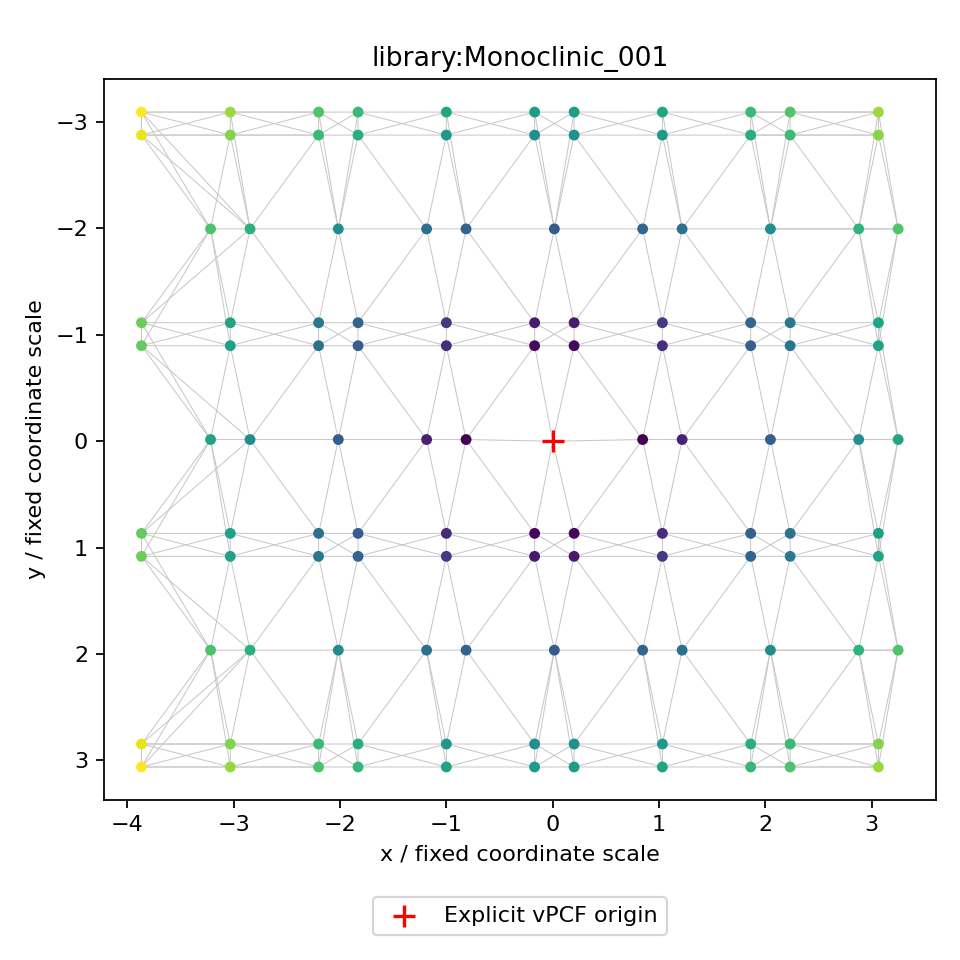
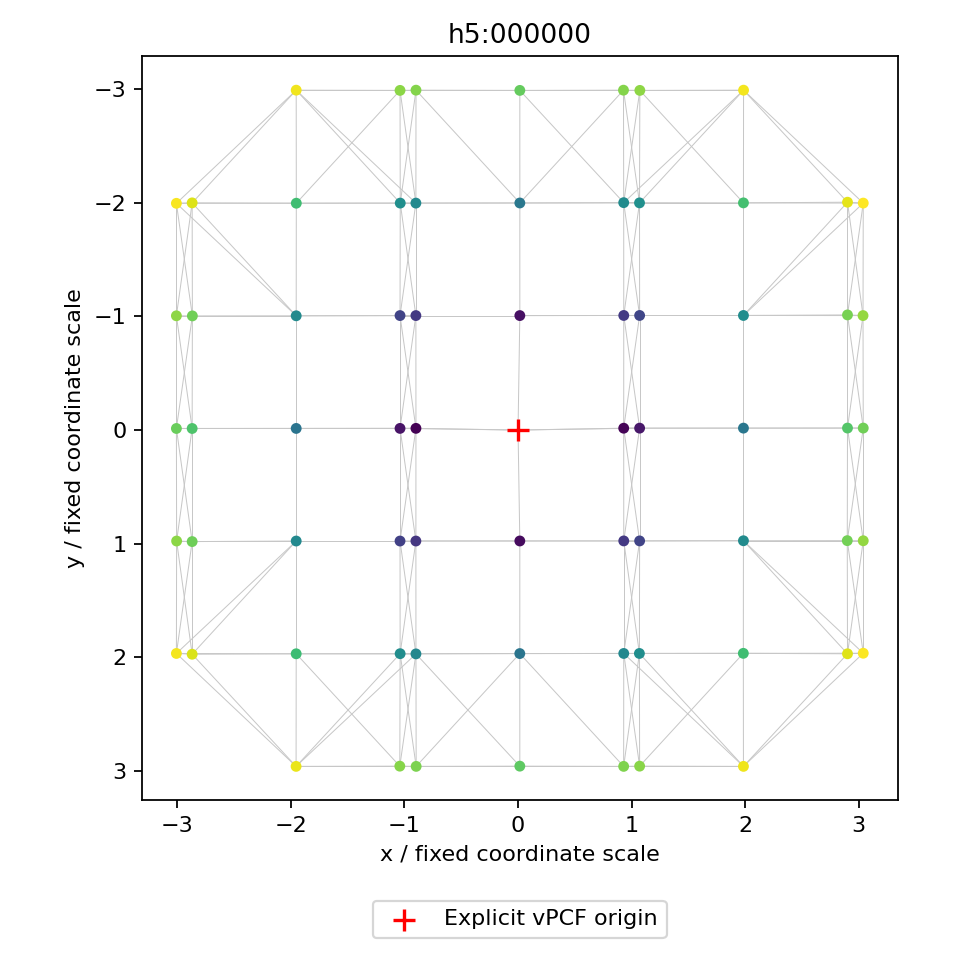
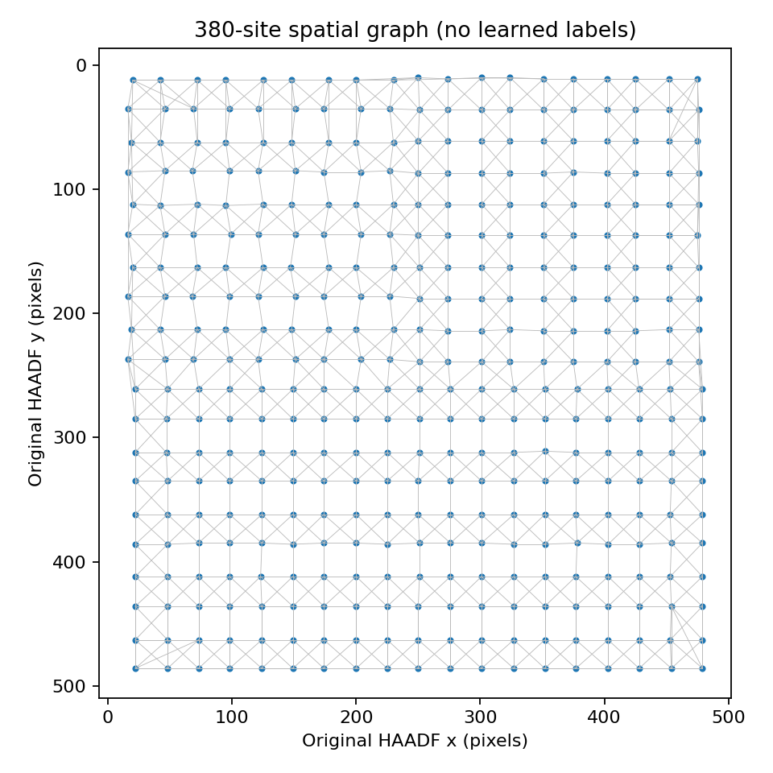
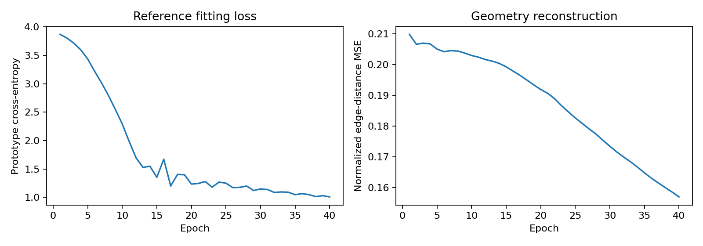

# PIGNN graph and reference-encoder development run

This run builds and exercises the graph-input and reference-encoder stage.
It is a development fit on the stored reference library, with unvalidated
nearest-reference candidates for the original image. It does not establish
phase/interface accuracy or generalization.

## Completed artifacts

| Item | Result |
|---|---:|
| Original H5 local vPCF graphs | 380 |
| Simulation-library graphs / exact phase-view labels | 51 |
| Library crystal-family groups | 6 |
| Spatial graph nodes | 380 |
| Spatial directed neighbor edges | 2,454 |
| Embedding dimensions | 32 |
| Reference fitting epochs | 40 |
| Original-image candidate exports | 380 |
| New foundation tests passed | 13 |
| Existing baseline regression tests passed | 19 |

`inputs/` contains numeric graph archives, the spatial graph, graph inventory,
source/configuration hashes and previews. `encoder/` contains fitted weights,
class prototypes, reference embeddings, loss histories, a training manifest and
a loss figure. `candidates/` contains all original sample embeddings, squared
prototype distances, candidate labels and atomic coordinates. The candidate
status is `unvalidated_library_candidate` in every record. `verification.json`
records the independent audit, and `logs/` retains execution/test evidence.

## Design used

The source producer defines origin-relative `(y,x,sigma_y,sigma_x,ellipticity)`
peak records. We preserve sample IDs, convert the displacement order to internal
x/y, add a marked origin and construct symmetric nearest-neighbor graphs. The
encoder's local inputs do not contain absolute HAADF position. A separate spatial
graph retains those original coordinates for a future context/interface head.

The default directional message-passing encoder preserves the library's
phase-and-view distinctions. It uses prototype cross-entropy on noise-augmented
reference views and a denoising edge-length reconstruction term. Architecture,
loss weights, fixed numeric scaling and augmentation values are development
choices, not optimized or scientifically validated settings.

The cited rationale, alternatives and limitations are in
[DESIGN.md](../../docs/DESIGN.md), [DATA_CONTRACT.md](../../docs/DATA_CONTRACT.md),
[EVALUATION.md](../../docs/EVALUATION.md) and [REFERENCES.md](../../docs/REFERENCES.md).

## Observed fitting behavior

Across the 40 reference-fitting epochs:

- Total training objective changed from 3.89105 to 1.02276.
- Reference prototype cross-entropy changed from 3.87006 to 1.00707.
- Normalized denoising edge-distance MSE changed from 0.20989 to 0.15696.
- Representation parameters, excluding the geometry decoder, moved by L2 norm
  1.17181 from their seeded initialization.

These are training diagnostics. The 51 stored templates have no independent
held-out examples per class, so the run reports no validation/test accuracy.
The 380 image graphs did not participate in reference fitting. Their physical
calibration and ground truth remain unverified, so this separation alone does
not establish valid cross-domain predictions.

## Verification

All 13 new tests passed, including upstream axis/centering contracts, numeric
archive round trips, symmetric tied-neighbor edges, permutation behavior,
arbitrary-angle rotation/reflection behavior in optional invariant mode,
graph-batch isolation, exclusion of absolute image location from the encoder,
training/reload and group/spatial leakage guards. All 19 existing baseline tests
passed without modifying the baseline model code.

The independent run audit verified all 431 local graphs, source IDs, spatial
coordinate joins, checkpoint replay, and all 380 candidate distances against a
separate NumPy calculation. It verified actual representation weight movement,
not only movement in the geometry decoder. Graph previews and training curves
were visually inspected.

## Previews

## Remaining scientific gates

Confirm the H5 producer schema and reference/image calibration, establish
independent simulation parents and physically valid symmetry policy, and obtain
aligned bulk/interface labels. Select hyperparameters and unknown thresholds on
independent validation data. Add the spatial context head only with controlled
split connectivity. No energy/force residual or six-environment label assignment
is invented in this stage.
