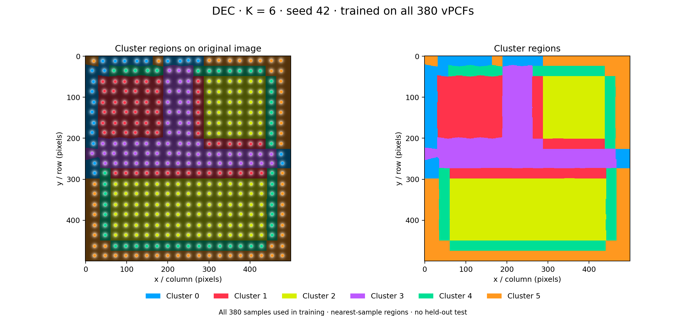
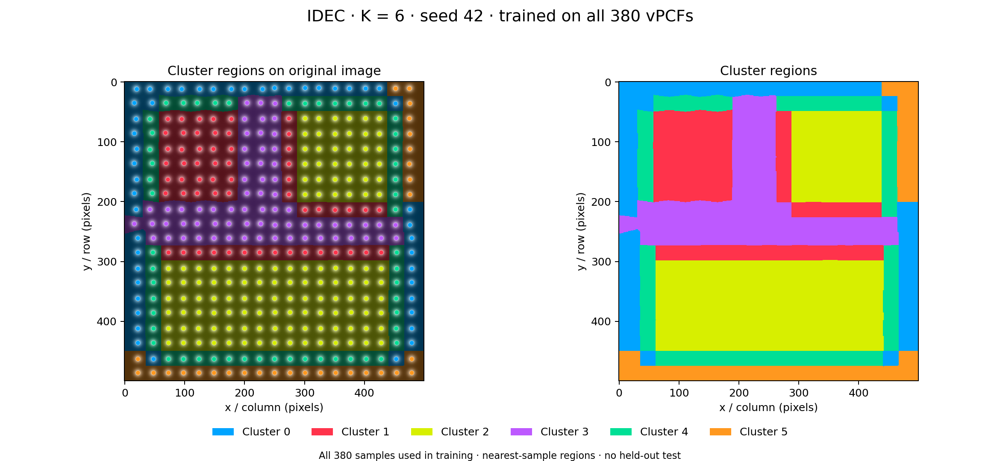

# Full-sample original-vPCF clustering, K=6

Fresh DEC and IDEC weights trained on all 380 original H5 vPCF samples. All assignments are from models fitted on those 380 samples. No 12-sample weights were reused.

This is transductive full-image clustering. There is no held-out split, so internal scores and seed stability do not measure generalization. No aligned physical ground-truth mask is available, so phase accuracy, interface F1 and boundary accuracy are not reported.

## Protocol

Five seeds [42, 43, 44, 45, 46]. Seven statistical features per vPCF, min-max scaling fitted on all 380. Architecture 7–500–500–2000–6, mirrored autoencoder. 50 autoencoder epochs with Adam (batch 64), then 200 full-batch SGD updates (learning rate 0.01), targets refreshed every five updates. DEC minimizes KL; IDEC minimizes reconstruction MSE + 0.1 KL. No early stopping or hyperparameter selection on these results.

The earlier smoke test used 12 samples, one pretraining epoch and two refinement updates. Training coverage, duration and fitted scaling all changed here. Differences from that run cannot be attributed solely to adding samples. Statistical features summarize intensity distributions and do not retain full vPCF peak geometry.

## Final occupied clusters

| Model | Seed | Cluster counts, IDs 0–5 |
|---|---:|---|
| DEC | 42 | [22, 63, 126, 66, 48, 55] |
| DEC | 43 | [126, 42, 69, 22, 56, 65] |
| DEC | 44 | [51, 126, 55, 64, 60, 24] |
| DEC | 45 | [54, 126, 60, 43, 18, 79] |
| DEC | 46 | [126, 23, 42, 55, 65, 69] |
| IDEC | 42 | [47, 57, 126, 66, 54, 30] |
| IDEC | 43 | [126, 46, 68, 26, 49, 65] |
| IDEC | 44 | [57, 126, 49, 64, 57, 27] |
| IDEC | 45 | [64, 126, 49, 57, 27, 57] |
| IDEC | 46 | [126, 26, 46, 49, 65, 68] |

All seeds are saved without selection. Seed 42 is the fixed reference for viewing figures. Cluster IDs are arbitrary across runs. Six requested centers do not guarantee six occupied or physically distinct environments.

## Artifacts

Each seed/model directory contains final weights, initial and learned embeddings/centers, probabilities and assignments, both training histories, metrics, population counts, training/reload verification, original-image atomic and region maps, and a loss/population plot. The existing VPCFToImageMapper joins original sample IDs and atomic coordinates. Nearest-sample filling produces display regions without smoothing or semantic relabeling.

Region edges extend nearest atomic assignments over image pixels, including the image borders. They are visualization boundaries, not measured interfaces. No cluster text markers are drawn inside the image; legends identify all six cluster IDs.

## Reproduce

`python run_full_sample_k6.py --output Results/Full_Runs/<new-directory>` from Phase Boundary Testing, with repository dependencies plus TensorFlow and ncempy. Source H5/DM3 files remain local and are identified by SHA-256 in the manifest. Source scripts are snapshotted in source/.

Elapsed run time: 609.7 seconds. Every final model passed fresh-instance checkpoint reload and sample-to-region label round-trip checks.
## Internal clustering and stability

Input-space metrics use the same seven normalized statistical features for both models. Values are means ± sample SD across five seeds. Seed agreement is descriptive stability on this same image, not accuracy.

| Model | Input silhouette | Input Davies–Bouldin | Mean pairwise seed ARI |
|---|---:|---:|---:|
| DEC | 0.62444 ± 0.01233 | 0.74484 ± 0.02195 | 0.94300 |
| IDEC | 0.64232 ± 0.00988 | 0.70793 ± 0.03716 | 0.94467 |

## Reference maps (fixed seed 42)

### DEC

### IDEC

## Verification

All 19 existing repository tests passed. Independent artifact auditing verified all ten model runs, 380 training flags per run, all probability/label arrays, original-coordinate joins and every nearest-sample region pixel. Every checkpoint reloaded into a fresh model and reproduced its stored predictions. Encoder and cluster-center movement are positive in every run.

`python verify_full_sample_k6.py --run Results/Full_Runs/synthetic_h5_full380_k6_20261025` reruns the artifact audit. Logs are training.log, tests.log and artifact_audit.log. The two reference maps were visually inspected.
